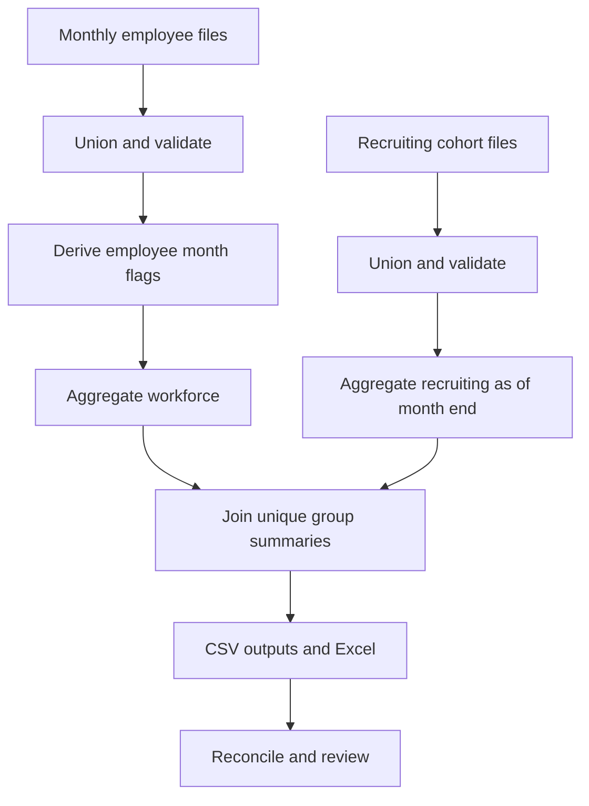
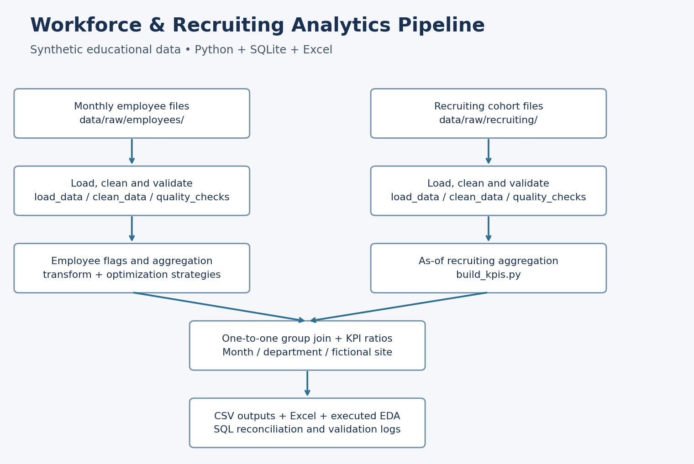

# Workforce & Recruiting Analytics Pipeline

**SYNTHETIC EDUCATIONAL PROJECT.** Employee upload treated as teaching data; original provenance is unconfirmed. Dates, monthly history, locations, exit reasons and recruiting data are simulated. No real employer impact is claimed.

## Start here

**To view the result:** open `excel/workforce_summary.xlsx`, then change the yellow month selector on Summary. The workbook has an Excel dashboard, department and tenure summaries, salary by level, original-sample attrition comparisons, and an employee ID lookup.

**To run the project:** from this folder:

```bash
python -m pip install -r requirements.txt
python src/pipeline.py
```

Python 3.10+ required. No Alteryx installation, cloud account, API key or database server is needed. Inputs and computed outputs are included. Optional LibreOffice automatically recalculates and checks the workbook if installed; otherwise open the generated workbook in Excel for calculation.

To regenerate the seeded demo inputs deliberately: `python src/pipeline.py --generate-demo`.

## Business problem

HR needs a repeatable monthly pack for workforce size, attrition and recruiting speed. This project unions monthly files, validates their grain and dates, derives event flags, summarizes each population separately, joins group summaries and exports CSVs plus an Excel model.

## What is included

- 1,470 original employee records, represented by 16,131 simulated employee-month records in 12 files.
- 2,400 synthetic applications in 12 monthly cohort files; fixed seed 42.
- 108 month/department/site output groups for January–December 2025.
- Modular Python pipeline, an executed EDA notebook, independently reconciled SQLite KPI query, two aggregation implementations, measured benchmark, Excel model and refresh runbook.
- Optional one-page Tableau specification. No Tableau workbook built. Alteryx was removed from scope at the user's request; no Alteryx execution or file is claimed.

## Workflow





Tools: Python, pandas, NumPy, SQLite, matplotlib, openpyxl, Excel formulas and optional LibreOffice for independent recalculation. No external GenAI API is required; AI assistance is disclosed in docs/genai_usage.md.

## KPI list

Closing headcount; attrition rate; voluntary exit rate; involuntary exit rate; average active tenure; application-to-acceptance time to hire; offer acceptance among decided offers; average monthly income by level; overtime share; application-to-offer cohort conversion. Exact definitions: docs/kpi_definitions.md. Attrition uses (opening + closing)/2, not opening headcount alone. Rates are stored as fractions and displayed as percentages.

## Optimization — measured aggregation only

| Version | Median seconds | Logical steps | Output CSV bytes |
|---|---:|---:|---:|
| Baseline | 0.044651 | 21 | 8920 |
| Optimized | 0.004821 | 2 | 8920 |

Absolute difference: 0.039830 seconds. This is a small absolute gain on a small dataset, not measured monthly labor savings. The two implementations produce identical outputs. Scope, runs and machine/library context are recorded in docs/optimization_log.md and data/output/benchmark.json.

## Validation

Latest run: **90 pipeline checks passed**. These include unique keys, ISO date parsing, no exit before hire, monthly membership, row retention, group roll-forward, exit reason reconciliation, independent department headcount totals, recruiting counts and Excel exported count reconciliation. Workbook calculation engine status is in data/output/excel_verification.json. Microsoft Excel itself was not automated.

Boundary tests: `python -m unittest discover -s tests -p "test_*.py"`. Tests cover month-start/month-end exits, same-month hires and exits, zero denominators, and future recruiting decisions. See docs/validation_log.md for the latest pipeline results.

## Where should HR act first?

Investigate overtime workload in Research & Development first: 74/271 overtime employees have Attrition=Yes (27.3%).

This prioritizes attrition-label volume within overtime groups. Review the department cross-tab as well as percentages; a smaller group may have a higher rate. Investigate workload allocation and staffing coverage, then validate the hypothesis using real dated data before a pilot. Evidence, three descriptive pattern comparisons and caveats are in docs/insights.md. Synthetic associations do not establish causation or prove an intervention will reduce attrition.

## Data quality and limitations

The original file has no nulls, duplicate rows or duplicate employee IDs. Three fields are constant. IQR flags identify unusual values, not proven errors; none were removed. No artificial dirt was inserted. Currency is unspecified. The source has no dates, locations, exit reasons or recruiting data. The simulated history holds employee attributes fixed and ignores transfers, rehires and pay changes. It is not a workforce forecast.

Recruiting is a separate synthetic population. Accepted applications do not equal employee hires. There is no applicant-to-employee crosswalk, and no source-of-hire attrition claim. Both tables are aggregated to month + department + fictional site before a one-to-one join. Original-sample insight analysis uses each employee once, avoiding inflated sample size from repeated monthly records. The original attrition share is not a monthly attrition rate.

## Files

`data/raw/source/` original upload; `data/raw/employees/` monthly snapshots; `data/raw/recruiting/` application cohorts; `data/output/` CSVs and logs; `src/` modular Python pipeline; `tests/` boundary tests; `notebooks/` executed EDA; `sql/` verified SQLite KPI logic; `optimization/` strategies and measured results; `logs/` generated logs; `data/interim/` cleaned intermediates; `excel/` workbook; `dashboard/` optional specification and preview; `docs/` definitions, quality log, dictionary, simulation rules, optimization, validation, refresh, insights and GenAI disclosure.

### Main analysis-ready outputs

| File | One row represents | Purpose |
|---|---|---|
| data/output/master_employees.csv | One employee | Original attributes, simulated employment dates, exit flag and tenure at exit or reporting cutoff |
| data/output/recruiting_funnel.csv | One application | Synthetic stage dates and final known offer outcome |
| data/output/kpi_monthly.csv | Month + department + fictional site | Workforce and recruiting numerators, denominators and weighted KPI ratios |

Supporting monthly, tenure, level and attrition-pattern tables are also provided. Intermediate cleaned rows and monthly derived flags live in data/interim/. Runtime logs live in logs/ and are gitignored.

### Source modules

| File | Responsibility |
|---|---|
| src/config.py | Paths, reporting window, seed, locations and threshold |
| src/load_data.py | Read and union monthly inputs |
| src/clean_data.py | Strip labels, parse dates, reject invalid keys |
| src/transform.py | Tenure bands, monthly flags, employee master and safe joins |
| src/quality_checks.py | Validation gates and log |
| src/build_kpis.py | Recruiting counts and all KPI ratios |
| src/generate_recruiting_data.py | Seeded recruiting and employee-history simulation |
| src/pipeline.py | Run all stages with one command |

Additional focused modules build Excel, execute EDA, draw the workflow, analyze attrition and compare SQLite outputs. There is no legacy workflow/ monolith.

### Notebook and alternative pipeline modes

Open `notebooks/01_eda.ipynb` in VS Code or Jupyter. It includes executed outputs and charts; the pipeline regenerates it directly, without requiring a Jupyter server. Explore schema, nulls, duplicates, outliers, distributions, three attrition patterns and monthly/SQL reconciliation.

Run `python optimization/baseline_pipeline.py` or `python optimization/optimized_pipeline.py` to execute the complete workflow using the corresponding employee aggregation strategy. Both share the same validated business logic. Their seven-repeat benchmark measures the aggregation stage only, not the complete run. Read `optimization/benchmark_results.csv` for measured runtime, step count, output bytes and equality.

SQLite SQL is in `sql/kpi_monthly.sql` and executes automatically against intermediate employee flags and cleaned application records. All keys and numerical fields are checked against Python results. No external database service is needed.

## Screenshots

- Summary preview: `dashboard/screenshots/summary_preview.png` when supplied with the delivery.
- Add your own Excel screenshot after selecting a different month: `[screenshot placeholder]`.
- Optional Tableau screenshot, only if built: `[screenshot placeholder]`.

## Interview explanation

“I combined monthly employee snapshots and recruiting cohorts with Python, validated their keys and dates, calculated monthly workforce and hiring KPIs, and produced a reconciled Excel pack. I measured two aggregation approaches and checked their outputs matched. Because the source lacked dates, I clearly separated simulated history from the original-sample attrition analysis.”

LinkedIn: https://www.linkedin.com/in/isfaque-ansari-/
